<!--
SPDX-License-Identifier: Apache-2.0
SPDX-FileCopyrightText: 2026 Desktiny Expansion Pack contributors
-->

Tiếng Việt | [English](README_EN.md)

<p align="center">
</p>

<p align="center"></p>

<h1 align="center">Desktiny Expansion Pack</h1>

<p align="center">
<b>Đưa Desktiny vào một nghiệp vụ mới bằng một tệp .zip, không sửa mã.</b><br>
Gói giao diện và plugin cho nhân sự, một cửa cấp xã, văn thư, vận hành thiết bị và quản trị dữ liệu.
</p>

<p align="center">
<a href="LICENSE"></a>
<a href="https://github.com/Dking2007/Desktiny_expansion_pack/actions/workflows/ci.yml"></a>
<a href="https://github.com/Dking2007/Desktiny_expansion_pack/releases"></a>

</p>

<p align="center">
<a href="https://github.com/Dking2007/DXOS_Desktiny">Sản phẩm chính</a> ·
<a href="#đóng-gói">Tải / đóng gói bản mở rộng</a> ·
<a href="#tự-tạo-bản-mở-rộng">Tự tạo bản mở rộng</a> ·
<a href="sdk">SDK</a>
</p>

<p align="center">
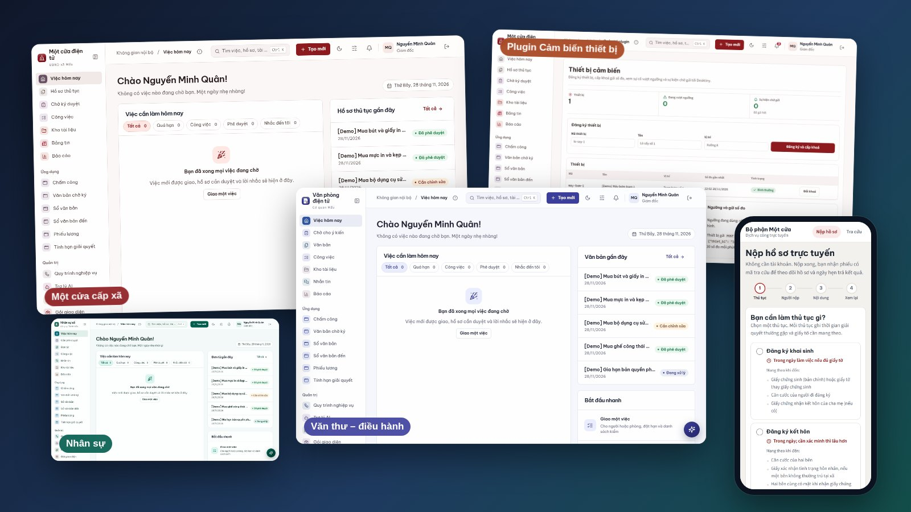<br>
<sub>Desktiny sau khi cài các bản mở rộng mẫu (dữ liệu mẫu giả).</sub>
</p>

| Expansion Pack | Desktiny tối thiểu | Đã chạy thử |
|---|---|---|
| 1.1.0 | 3.1.0 | 28/11/2026: job CI `cai-vao-desktiny` trên GitHub cài mọi gói và plugin vào Desktiny tag `v3.1.0` rồi chạy luồng ([lần chạy 46137625759](https://github.com/Dking2007/Desktiny_expansion_pack/actions/runs/46137625759)): 6 đạt, 2 bỏ qua (B1, B8: hai lỗi Desktiny đã sửa sau 3.1.0); với Desktiny `main` (bản sẽ phát hành 3.2.0) chạy đủ trên máy; cùng ngày duyệt tay một hồ sơ Một cửa trên bản Desktiny dựng từ `main`, hồ sơ đóng đúng |

> Chưa có bản phát hành trên GitHub (dự kiến `v1.1.0`). Hiện lấy các tệp `.zip` bằng cách đóng gói từ mã nguồn,
> xem mục [Đóng gói](#đóng-gói).

## Mục lục

[Bản mở rộng là gì](#bản-mở-rộng-là-gì) · [Giao diện](#giao-diện) · [Các bản mẫu](#các-bản-mẫu) ·
[Đóng gói](#đóng-gói) · [Cài vào Desktiny](#cài-vào-desktiny) · [Tự tạo bản mở rộng](#tự-tạo-bản-mở-rộng) ·
[An toàn](#an-toàn) · [Công nghệ và giấy phép](#công-nghệ-và-giấy-phép) · [Giới hạn](#giới-hạn) ·
[Phát triển và kiểm thử](#phát-triển-và-kiểm-thử) · [Đóng góp](#đóng-góp) · [Đội](#đội) · [Giấy phép](#giấy-phép)

## Bản mở rộng là gì

Một bản mở rộng đưa [Desktiny](https://github.com/Dking2007/DXOS_Desktiny) vào một nghiệp vụ cụ thể (nhân sự, một
cửa, văn thư, vận hành thiết bị…) mà **không sửa mã của Desktiny**. Nó gồm một **gói giao diện** (màu sắc, từ ngữ, quy
trình, biểu mẫu, kiến thức cho trợ lý AI) và các **plugin** thêm chức năng mới. Tất cả cài qua trang quản trị của
Desktiny bằng tệp `.zip`.

Repo này có:

- **Năm bản mẫu** dùng thử được ngay, để xem một bản mở rộng hoàn chỉnh trông thế nào.
- **Công cụ đóng gói**: bấm đúp `build.bat` là có các tệp `.zip` để cài.
- **Bộ khung** để tự viết plugin: máy chủ plugin dựng sẵn (`lib/mo_rong`), SDK cho trang, cấu hình Docker và test.
- **Hướng dẫn tự tạo** bản mở rộng cho nghiệp vụ của bạn ([`docs/tu-tao-ban-mo-rong.md`](docs/tu-tao-ban-mo-rong.md)).

Mỗi bản mở rộng là một thư mục trong `expansion/`:

```
expansion/<tên bản mở rộng>/
├── README.md                giới thiệu bản mở rộng
├── packs/<tên gói>/         gói giao diện (thường một gói)
├── plugins/<tên plugin>/    các plugin (không bắt buộc)
└── dung-chung.json          plugin mượn của bản mở rộng khác (không bắt buộc)
```

| Thành phần | Là gì | Cần biết lập trình? | Cần máy chủ riêng? |
|---|---|---|---|
| **Gói giao diện** (`desktiny-pack/1`) | Dữ liệu thuần: tên, logo, màu, trang đăng nhập, từ ngữ, menu, trang chủ, quy trình và biểu mẫu, luồng tự động, kiến thức cho trợ lý AI | Không: tạo được ngay trong Desktiny rồi xuất ra | Không |
| **Plugin đóng gói** (`desktiny-plugin/2`) | Trang web (HTML, JS) chạy trong khung cách ly của Desktiny, tính toán ngay trên trình duyệt | HTML và JavaScript | Không |
| **Plugin kết nối** (`desktiny-plugin/1`) | Trang web cùng một máy chủ riêng (Python, SQLite). Desktiny gọi máy chủ khi có sự kiện, bước quy trình hay câu hỏi của trợ lý AI | Python | Có, chạy bằng Docker Compose |

Một plugin gắn vào Desktiny ở nhiều chỗ: trang riêng trên thanh bên; khung hoặc tab trên hồ sơ, công việc; nút thao
tác; khối trên trang chủ; bước trong quy trình; sự kiện để luồng tự động bắt đầu; công cụ cho trợ lý AI. Plugin chỉ
làm được những gì quản trị viên đã duyệt khi cài.

### Luồng dữ liệu

<p align="center">

</p>

<details>
<summary>Sơ đồ dạng chữ (Mermaid)</summary>

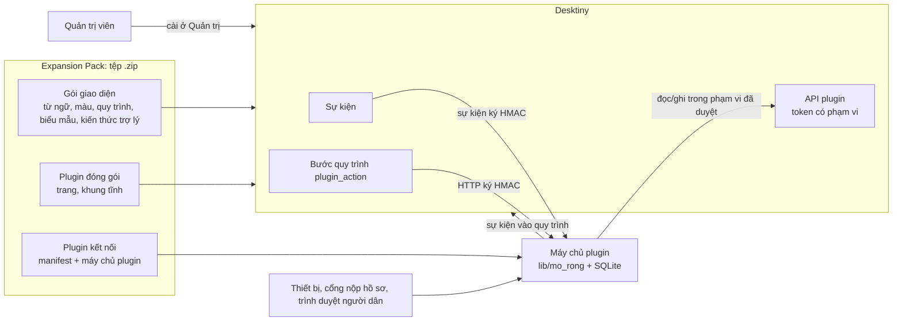

</details>

Không sửa mã Desktiny. Phạm vi của plugin là phần quyền quản trị viên đã duyệt khi cài. Màu mũi tên: xanh dương là yêu
cầu/phản hồi, nâu vàng là sự kiện, tím là tệp, nét đứt xám là thao tác tay.

### Từ mã nguồn đến Desktiny

Phần 1 của sơ đồ động ở trên vẽ bước này.

<details>
<summary>Sơ đồ dạng chữ (Mermaid)</summary>

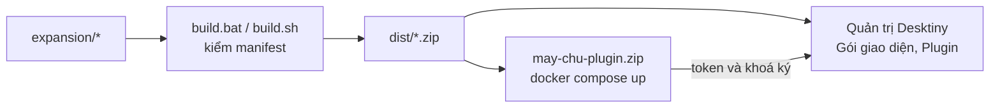

</details>

**Yêu cầu:** Desktiny **3.1.0** trở lên (bản 3.0.0 chưa cài được plugin `.zip` và bỏ qua các tuỳ biến đăng nhập
mới); Python 3.11+ để đóng gói; Docker cho máy chủ plugin kết nối.

## Giao diện

Ảnh chụp từ bản demo với dữ liệu mẫu giả (nguồn: [`docs/images/README.md`](docs/images/README.md)).

<p align="center">
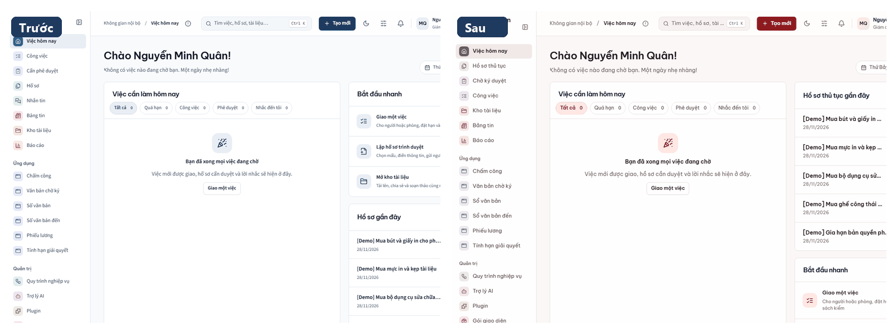<br>
<sub>Cùng một Desktiny trước và sau khi cài gói “Một cửa cấp xã”</sub>
</p>

<table>
  <tr>
    <td width="33%">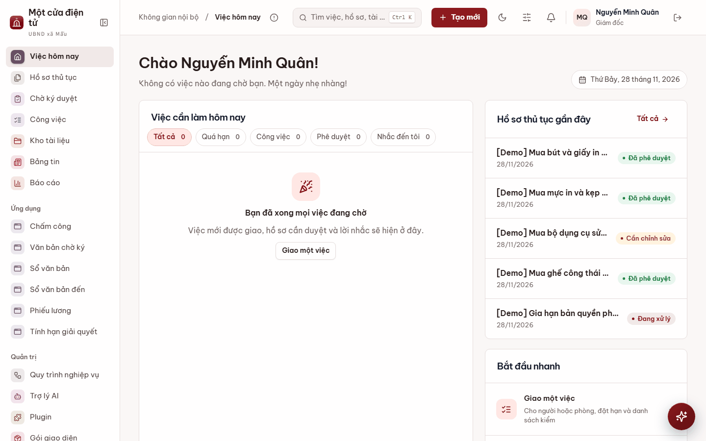<br><sub>Một cửa cấp xã</sub></td>
    <td width="33%">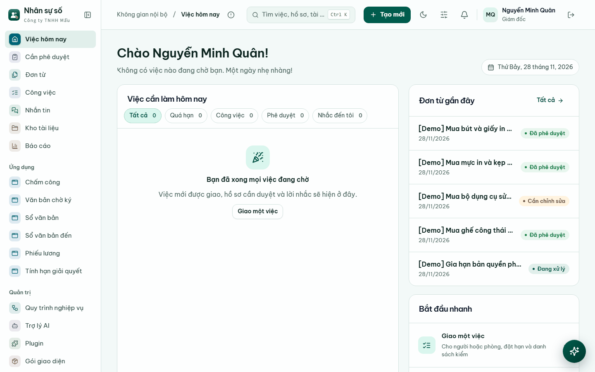<br><sub>Nhân sự doanh nghiệp</sub></td>
    <td width="33%">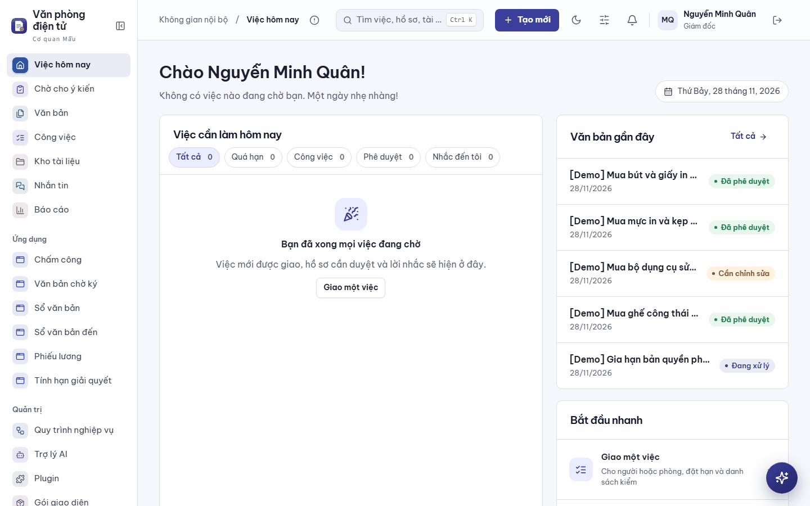<br><sub>Văn thư – điều hành</sub></td>
  </tr>
</table>

| 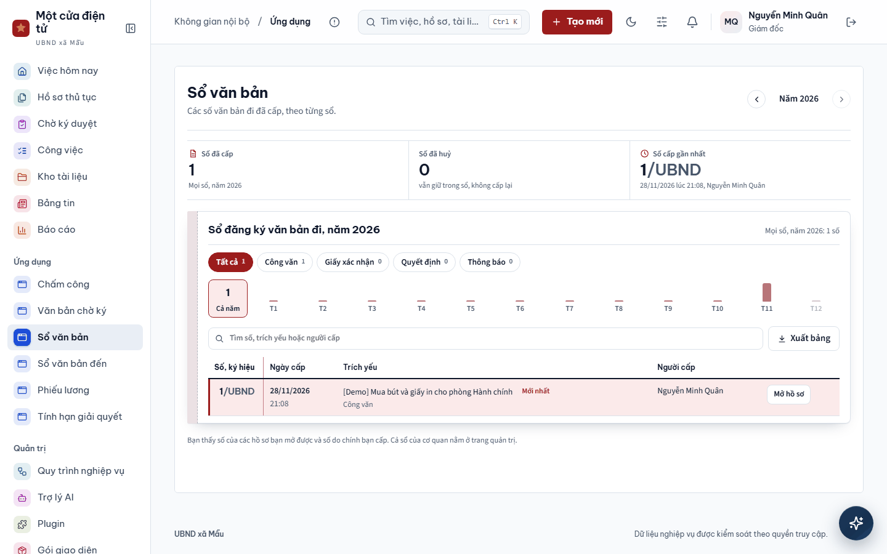 | 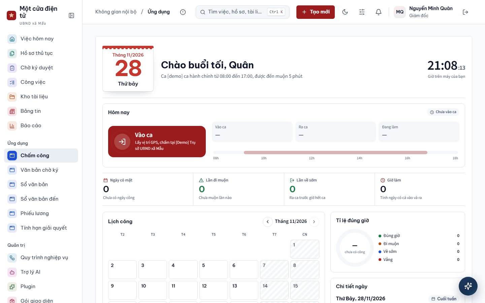 |
|---|---|
| Văn thư cấp số văn bản đi liên tục, không nhảy số | Nhân viên chấm công bằng vị trí trên điện thoại |
| 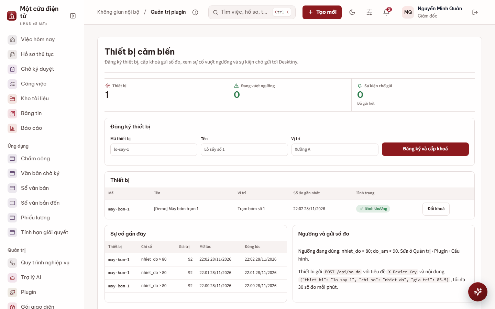 | 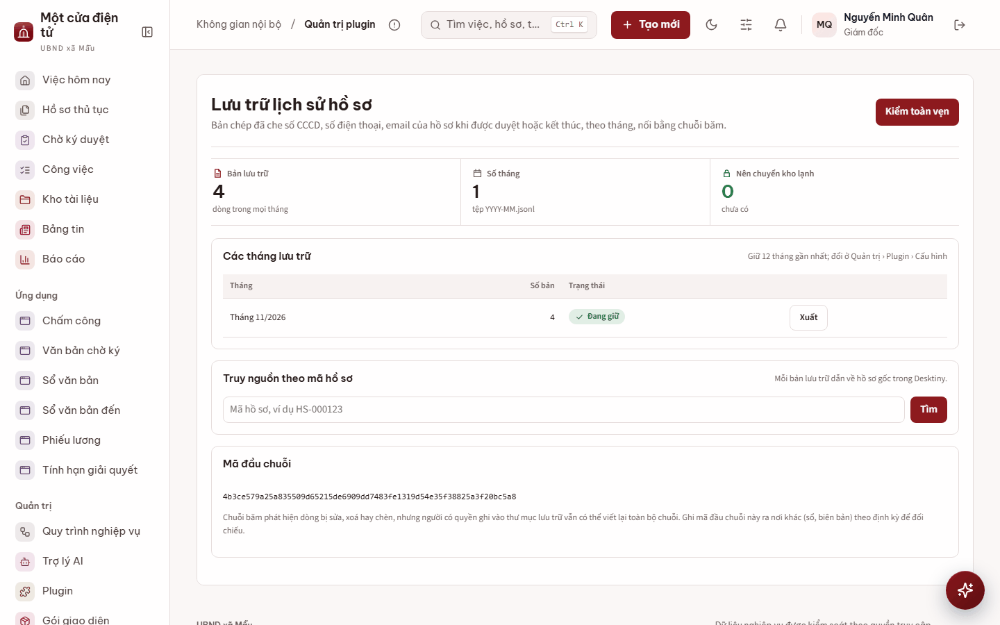 |
| Người phụ trách thấy thiết bị và các lần vượt ngưỡng | Quản trị viên kiểm tra chuỗi băm của hồ sơ đã lưu trữ |

<p align="center">
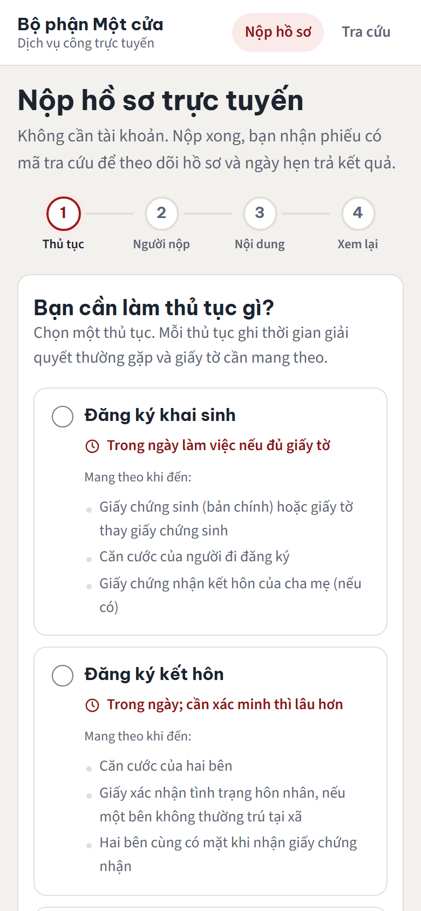<br>
Người dân nộp hồ sơ ngay trên điện thoại.
</p>

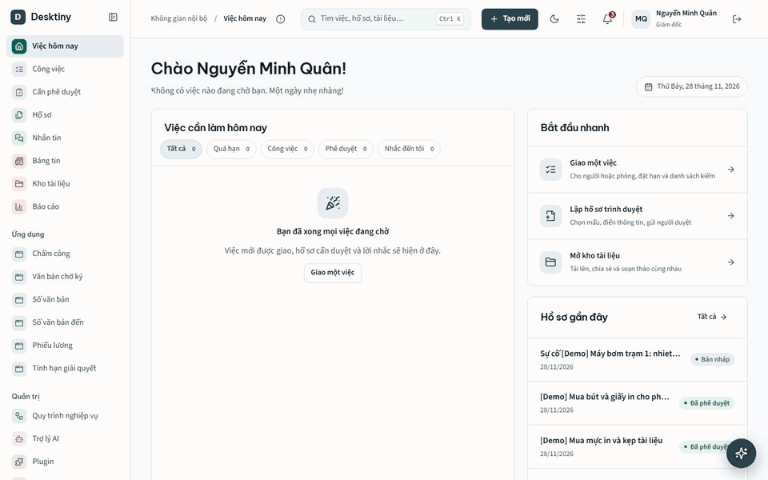

*Quản trị viên chọn gói giao diện; cả ứng dụng đổi sang Một cửa rồi Nhân sự.*

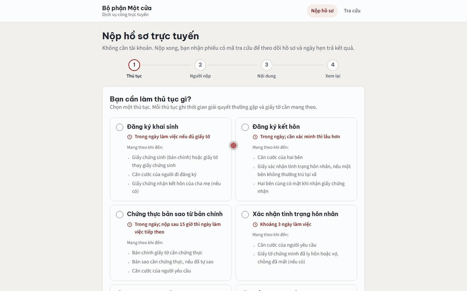

*Người dân nộp hồ sơ qua cổng công khai, hồ sơ xuất hiện cho cán bộ xử lý.*

Dữ liệu trong mọi ảnh và GIF là dữ liệu mẫu giả.

## Các bản mẫu

| Bản mẫu | Dành cho | Gói giao diện | Plugin |
|---|---|---|---|
| <br>[**Nhân sự doanh nghiệp**](expansion/nhan-su/README.md) `nhan-su` | Bộ phận nhân sự của doanh nghiệp, cơ quan nhỏ | 7 quy trình đơn từ, 3 luồng tự động, quy chế cho trợ lý AI | Chấm công GPS, Tiền lương và KPI, Nhắc hạn hồ sơ |
| <br>[**Một cửa cấp xã**](expansion/mot-cua-xa/README.md) `mot-cua-xa` | Bộ phận một cửa của UBND cấp xã | 6 thủ tục hộ tịch, chứng thực, hoà giải; 3 luồng tự động | Sổ văn bản, Ký số, Tiếp nhận trực tuyến, Tính hạn, Đọc giấy tờ |
| <br>[**Văn thư – điều hành**](expansion/van-thu/README.md) `van-thu` | Văn thư, văn phòng của cơ quan | Xử lý văn bản đến, ban hành văn bản đi, nộp lưu hồ sơ; 3 luồng tự động; hướng dẫn văn thư cho trợ lý AI | Sổ văn bản đến; dùng chung Sổ văn bản, Ký số, Tính hạn của bản Một cửa |
| <br>[**Vận hành – giám sát thiết bị**](expansion/van-hanh/README.md) `van-hanh` | Bộ phận vận hành, kỹ thuật có thiết bị cần theo dõi | Quy trình xử lý sự cố thiết bị; mẫu luồng “cảm biến vượt ngưỡng → hồ sơ sự cố”; không đổi giao diện | Cảm biến thiết bị (nhận số đo qua HTTP, cảnh báo vượt ngưỡng) |
| <br>[**Quản trị dữ liệu**](expansion/quan-tri-du-lieu/README.md) `quan-tri-du-lieu` (minh hoạ) | Người quản trị Desktiny | Không có | Lưu trữ lịch sử hồ sơ: chép hồ sơ đã duyệt, kết thúc (đã che CCCD, số điện thoại, email) ra tệp tháng có chuỗi băm; kiểm toàn vẹn, truy nguồn về hồ sơ gốc |

Mỗi bản mẫu có README riêng: nội dung, cách cài, cấu hình, luồng
gợi ý và những gì cần sửa trước khi dùng thật. Tên cơ quan trong bản mẫu là tên giả; quy chế, thời hạn và mức tiền chỉ
để minh hoạ.

### Vận hành và Quản trị dữ liệu chạy ra sao

<p align="center">

</p>

<p align="center">
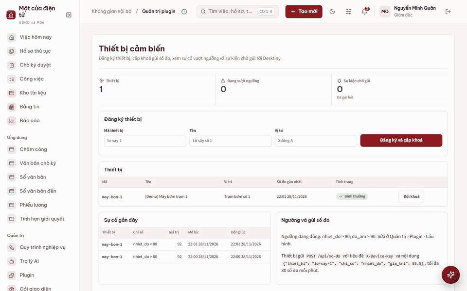<br>
<sub>*Thiết bị gửi số đo vượt ngưỡng; plugin ghi sự cố và luồng tạo hồ sơ sự cố giao người phụ trách (dữ liệu mẫu giả).*</sub>
</p>

Số đo trên biểu đồ là số mẫu, theo cách chạy của `scripts/gia_lap_cam_bien.py`. Với Desktiny 3.1.0, bước chủ luồng
trình hồ sơ nháp còn lỗi B8 (xem [Giới hạn](#giới-hạn)). Chi tiết: [Vận hành](expansion/van-hanh/README.md),
[Quản trị dữ liệu](expansion/quan-tri-du-lieu/README.md).

## Đóng gói

Chọn một cách:

| Cách | Lệnh |
|---|---|
| Windows | **Bấm đúp `build.bat`** → chọn từ danh sách (Enter = tất cả); xong sẽ mở thư mục `dist` |
| VS Code | **Ctrl+Shift+B** → “Đóng gói (dist/*.zip)” |
| Dòng lệnh | `python scripts/dong_goi.py` · `./build.sh` · `make build` |

### Chọn gói, plugin cần đóng gói

Bấm đúp `build.bat` sẽ hiện danh sách đánh số theo từng bản mở rộng. Gõ số hoặc tên, cách nhau bởi dấu cách; **Enter**
không gõ gì là đóng gói tất cả:

```
  Bản mở rộng mot-cua-xa  (gõ “mot-cua-xa” để lấy cả bản)
    1. Một cửa cấp xã  [gói giao diện, mot-cua-xa]
    2. Đọc giấy tờ, điền sẵn hồ sơ  [plugin đóng gói, doc-giay-to]
    …
Nhập số hoặc tên, cách nhau bởi dấu cách (Enter = tất cả): 1 2 ky-so
```

Từ dòng lệnh, ghi tên sau lệnh (không ghi gì = tất cả):

```sh
build.bat nhan-su                  # cả bản mở rộng Nhân sự: gói + 3 plugin
build.bat ky-so so-van-ban         # chỉ hai plugin
build.bat goi-nhan-su              # chỉ gói giao diện (tên bản mở rộng trùng tên gói thì thêm goi-)
python scripts/dong_goi.py --chon  # hiện danh sách như khi bấm đúp
make build CHON="nhan-su ky-so"
```

Tên là tên thư mục của bản mở rộng, gói hoặc plugin (`plugin-<tên>` cũng được). Gói máy chủ chỉ chứa các plugin kết
nối được chọn, và `HUONG-DAN-CAI.txt` ghi đúng lệnh `docker compose … up -d <các plugin đó>`. Chỉ chọn gói giao diện
và plugin đóng gói thì không có gói máy chủ.

### Đóng gói cho máy chủ thật

Khi triển khai thật, chỉ cho plugin kết nối biết máy chủ của chúng ở đâu:

```sh
build.bat --host plugins.co-quan.vn        # hoặc: python scripts/dong_goi.py --host plugins.co-quan.vn
                                           #       make build HOST=plugins.co-quan.vn
```

`--host` có dấu chấm (tên miền, IP) → `base_url` thành `https://<host>/<tên-plugin>` (đặt sau reverse proxy); tên máy
không có dấu chấm → `http://<host>:<cổng>`. Không có `--host`, `base_url` là `http://localhost:92xx` (để thử trên một máy).

Trước khi ghi, bước đóng gói **kiểm mọi manifest** theo quy tắc Desktiny áp dụng khi tải lên, và kiểm mọi tệp gói giao
diện trỏ tới (logo, quy trình, mẫu, kiến thức) có thật và đúng JSON. Có lỗi thì báo rõ tệp nào, không ghi gì cả.

### Kết quả trong `dist/`

`dist/` được làm trống rồi ghi lại mỗi lần đóng gói (chỉ còn những gì vừa chọn). Mỗi bản mở rộng một thư mục, cài thư
mục nào thì lấy đủ tệp ở đó. Đóng gói tất cả (19 tệp):

```
dist/
├── HUONG-DAN-CAI.txt                       tệp nào tải lên đâu, theo thứ tự
├── nhan-su/            goi-nhan-su-1.2.1.zip, plugin-cham-cong, plugin-luong-kpi, plugin-nhac-han
├── mot-cua-xa/         goi-mot-cua-xa-1.2.1.zip, plugin-tinh-han, plugin-doc-giay-to,
│                       plugin-so-van-ban, plugin-ky-so, plugin-tiep-nhan
├── van-thu/            goi-van-thu-1.1.1.zip, plugin-so-van-ban-den
│                       + bản sao plugin-so-van-ban, plugin-ky-so, plugin-tinh-han (dùng chung)
├── van-hanh/           goi-van-hanh-1.0.0.zip, plugin-cam-bien-1.0.0.zip
├── quan-tri-du-lieu/   plugin-luu-tru-lich-su-1.0.0.zip
└── may-chu-plugin/     may-chu-plugin-1.1.0.zip   mã máy chủ 9 plugin kết nối + Dockerfile + compose.yaml
```

Plugin kết nối chỉ có manifest trong `.zip` (trang do máy chủ plugin phục vụ); plugin đóng gói có cả manifest, trang và
SDK khung. Tên tệp có phiên bản lấy từ manifest (`version`). Cùng mã nguồn luôn cho ra cùng tệp .zip. Chọn riêng một
bản mở rộng thì gói máy chủ chỉ chứa plugin kết nối của bản đó.

## Cài vào Desktiny

Mở `dist/HUONG-DAN-CAI.txt`: tệp này ghi đúng những tệp vừa đóng gói và thứ tự cài. Thứ tự chung như sau.

### 1. Gói giao diện

**Quản trị › Gói giao diện › Tải gói lên (.zip)** → chọn `goi-*.zip` → xem trước → cài → **Dùng giao diện này**.
Cài gói cần quyền quản lý biểu mẫu và trợ lý AI. Cài nhiều gói được, nhưng chỉ một gói là giao diện đang dùng. Luồng tự
động trong gói được cài ở trạng thái tắt: xem lại người nhận rồi bật ở **Quy trình nghiệp vụ**.

### 2. Plugin đóng gói

**Quản trị › Plugin › Cài plugin** → chọn `plugin-*.zip` → **Duyệt quyền**. Không cần máy chủ.

### 3. Máy chủ plugin kết nối

1. Chép `dist/may-chu-plugin/may-chu-plugin-*.zip` lên máy chủ rồi giải nén.
2. `cp deploy/.env.example deploy/.env`, đặt `DESKTINY_URL` (địa chỉ để máy chủ plugin gọi tới Desktiny).
3. `docker compose -f deploy/compose.yaml --env-file deploy/.env up -d --build` (trong mã nguồn: `make up`). Một image
   dùng chung cho mọi plugin; dữ liệu SQLite nằm trong volume riêng của từng plugin.
4. Trong cấu hình Desktiny: thêm máy chủ plugin vào `PLUGIN_ALLOWED_HOSTS` (ví dụ `plugins.co-quan.vn`) và thêm
   origin vào `PLUGIN_FRAME_SOURCES` (ví dụ `https://plugins.co-quan.vn`).

Cổng và biến của từng plugin có trong README của bản mẫu. Nếu `--host` là tên miền, reverse proxy cần chuyển
`https://<host>/<tên-plugin>/…` tới cổng tương ứng.

### 4. Plugin kết nối

1. **Quản trị › Plugin › Cài plugin** → chọn `plugin-<tên>-*.zip` → **Duyệt quyền**.
2. Desktiny hiện **token** và **khoá ký** đúng một lần. Chép chúng vào `deploy/.env` (`<TÊN>_TOKEN`, `<TÊN>_SECRET`)
   rồi chạy lại `docker compose … up -d`.

### 5. Cấu hình

Ở trang **Plugin**, mỗi plugin có nút **Cấu hình** (cài đặt theo cơ quan; ô bí mật được mã hoá). Plugin có trang
quản trị thì mở từ nút tương ứng trên dòng plugin.

## Tự tạo bản mở rộng

Không cần làm tất cả. Phần lớn nhu cầu chỉ cần gói giao diện, mà không phải viết dòng mã nào. Chỉ thêm plugin khi
Desktiny chưa có sẵn chức năng bạn cần. Hướng dẫn đầy đủ có mã mẫu: **[`docs/tu-tao-ban-mo-rong.md`](docs/tu-tao-ban-mo-rong.md)**.

1. **Tạo thư mục** `expansion/<tên>/` (chép một bản mẫu gần nghiệp vụ nhất rồi sửa).
2. **Gói giao diện**: dựng trong Desktiny rồi xuất `.zip`, hoặc viết `desktiny-pack.json` tay.
3. **Plugin đóng gói** khi cần một trang hoặc khung tính toán chạy trên trình duyệt.
4. **Plugin kết nối** khi cần lưu dữ liệu, chạy nền, nhận sự kiện hay làm bước quy trình (dùng `lib/mo_rong`).
5. **Đóng gói, thử, viết README**: `build.bat <tên>`, cài thử, viết test, rồi theo danh sách kiểm tra trước phát hành.

## An toàn

Mọi bản mở rộng, kể cả bản bạn tự tạo, đều được hưởng các cơ chế sau của Desktiny và của bộ khung.

| Kênh | Xác thực | Phạm vi |
|---|---|---|
| Desktiny gọi plugin: sự kiện, bước `plugin_action`, công cụ trợ lý | Chữ ký HMAC-SHA256 của `<thời điểm>.<nội dung>` (`X-Desktiny-Signature`, `X-Desktiny-Timestamp`), có kiểm tuổi lời gọi. Báo kết quả của bước chạy lâu cũng được ký | Chỉ những gì Desktiny ký bằng khoá ký của đúng plugin |
| Plugin gọi API Desktiny | Token cài đặt (`Bearer`), cấp một lần khi duyệt quyền | Giao của quyền quản trị viên đã duyệt và token; chỉ hồ sơ plugin được báo hoặc thuộc quy trình được chọn; ghi trường biểu mẫu chỉ trong phiên một người dùng |
| Trang plugin gọi máy chủ plugin | Token phiên của khung (`X-Desktiny-Session`); máy chủ hỏi Desktiny người xem là ai (`GET /plugin/v1/me`) | Theo quyền của người xem; đường dẫn `admin=True` chỉ nhận phiên từ khung `admin.page` (người quản lý tổ chức) |
| Thiết bị gửi số đo (plugin Cảm biến) | Khoá thiết bị `X-Device-Key`, chỉ lưu mã băm SHA-256 | Một thiết bị đã đăng ký, giới hạn 30 số đo mỗi phút |

Các biện pháp khác:

- Trang của plugin chạy trong khung cách ly, không có `alert/prompt` và không tải tệp về được.
- Máy chủ plugin trả mọi lỗi dạng JSON; lỗi ngoài dự kiến chỉ ghi vào nhật ký container. Chỉ đọc `X-Forwarded-For`
  khi bật `TRUST_PROXY=1`.
- Container chạy bằng người dùng thường, hệ tệp chỉ đọc, `no-new-privileges`. Gói máy chủ không chứa `deploy/.env`.
- Gói giao diện là dữ liệu thuần, không chứa mã. Gỡ gói thì Desktiny trở về giao diện và nghiệp vụ mặc định.

Báo lỗ hổng: xem [SECURITY.md](SECURITY.md).

## Công nghệ và giấy phép

| Lớp | Thành phần | Phiên bản | Giấy phép (SPDX) | Vai trò | Cách dùng |
|---|---|---|---|---|---|
| Máy chủ plugin | Thư viện chuẩn Python (`http.server`) | Python ≥ 3.11 (CI dùng 3.13) | PSF (ngôn ngữ) | Máy chủ HTTP, định tuyến, kiểm chữ ký (`lib/mo_rong`) | Không có phụ thuộc pip |
| Dữ liệu | SQLite (thư viện chuẩn) | theo Python | Phạm vi công cộng | Dữ liệu riêng của từng plugin, một volume mỗi plugin | Nhúng trong tiến trình |
| Triển khai | Docker Compose, ảnh `python:3.13.5-slim-bookworm` | 3.13.5 | Giấy phép của ảnh nền | Một ảnh chung cho mọi plugin kết nối | Dịch vụ riêng |
| SDK Python | `lib/desktiny_plugin` | bản sao SDK của Desktiny | Apache-2.0 | Ký, kiểm chữ ký, gọi API plugin | Mã đi kèm |
| SDK trang | `sdk/desktiny-plugin-sdk.js`, `mo-rong.js`, `bieu-do.js`, `chung.css` | cùng bản repo | Apache-2.0 | Trang plugin nói chuyện với khung Desktiny và máy chủ plugin | Mã đi kèm |
| Phông chữ | Be Vietnam Pro, Source Sans 3 (`sdk/phong-chu/`) | tập con latin, vietnamese | OFL-1.1 | Chữ cho trang plugin | Tệp `.woff2` đi kèm |
| Công cụ | pytest ≥ 8, ruff ≥ 0.6, Node 22 (`node --test`) | xem `pyproject.toml` | MIT / MIT / MIT | Kiểm thử, lint | Không đi vào sản phẩm |

Chi tiết và nguồn: [THIRD_PARTY.md](THIRD_PARTY.md), [NOTICE](NOTICE). Mọi tệp có khai báo giấy phép theo chuẩn
[REUSE](https://reuse.software/).

## Giới hạn

- **Chấm công GPS** tin vị trí do trình duyệt báo lên, nên người dùng có kỹ thuật có thể làm giả. Trình duyệt chỉ cho
  lấy vị trí khi trang chạy trên HTTPS (trừ `localhost`).
- **Cổng tiếp nhận trực tuyến** lưu số CCCD và số điện thoại không mã hóa, chưa có thời hạn lưu giữ. Cần bổ sung trước
  khi dùng với dữ liệu thật.
- **Ký số** là chữ ký mô phỏng bằng HMAC, không phải chữ ký số có giá trị pháp lý.
- Quy chế, thủ tục, thời hạn, ngày lễ và mức tiền trong các bản mẫu chỉ để minh hoạ.
- **Với Desktiny 3.1.0** còn hai lỗi phía Desktiny, đã sửa ở nhánh `tich-hop/olp-2026-11-28` (bản phát hành sau 3.1.0):
  - Hồ sơ của các quy trình trong gói (kết thúc bằng bước thông báo, không có bước Kết thúc) kẹt ở “Đang xử lý” sau
    bước duyệt cuối (B1).
  - Chủ hồ sơ không trình được hồ sơ do bước **Tạo hồ sơ** của luồng tạo ra, nên sổ tiếp nhận trực tuyến không gắn được
    hồ sơ (B8).

## Phát triển và kiểm thử

### Cấu trúc thư mục

```
build.bat, build.sh     nút đóng gói (gọi scripts/dong_goi.py)
scripts/                dong_goi.py (kiểm manifest, đóng gói), kiem_phien_ban.py, gia_lap_cam_bien.py
expansion/<bản>/        các bản mở rộng (README.md, logo, packs/, plugins/, dung-chung.json)
lib/mo_rong/            bộ khung máy chủ plugin: định tuyến, kiểm chữ ký, phiên người xem, giới hạn tần suất, SQLite, tệp Word, tiện ích tiếng Việt
lib/desktiny_plugin/    bản sao SDK Python của Desktiny, cập nhật cùng Desktiny
sdk/                    SDK khung của Desktiny, mo-rong.js (trang gọi máy chủ plugin), chung.css, phông chữ
tests/                  test máy chủ plugin (Desktiny giả), test đóng gói, tests/js (Node), tests/desktiny (Desktiny thật)
deploy/                 Dockerfile, compose.yaml, .env.example
docs/                   hướng dẫn tự tạo bản mở rộng; images/ (banner, logo Desktiny, ảnh, sơ đồ động), media/ (GIF)
```

### Kiểm thử

| Lệnh | Kiểm gì | Cần gì |
|---|---|---|
| `make test` | Máy chủ plugin và đóng gói | Python 3.11+, pytest |
| `make test-js` | Mã trang của plugin đóng gói | Node 22 |
| `make test-desktiny` | Cài mọi gói và plugin vào Desktiny thật rồi chạy luồng | Mã nguồn Desktiny (`DESKTINY_DIR`, mặc định thư mục cha) |
| `make lint` | Phong cách và lỗi mã Python | ruff |
| `make dist` | Đóng gói thử vào `dist/` | Python 3.11+ |
| `reuse lint` | Mọi tệp có khai báo giấy phép | công cụ `reuse` |

Không có `make` (Windows): `set PYTHONPATH=lib` rồi `python -m pytest -q tests --ignore=tests/desktiny`;
`node --test tests/js/*.test.mjs`. Trong VS Code: tác vụ “Kiểm thử”. CI chạy lint, test, test-js, đóng gói, và cài thử
vào Desktiny `v3.1.0`.

### Chạy thử một plugin

```sh
PYTHONPATH=lib DESKTINY_URL=… DESKTINY_TOKEN=… DESKTINY_SECRET=… python expansion/nhan-su/plugins/cham-cong/server.py
PYTHONPATH=lib python -m desktiny_plugin.cli dev step cap_so_van_ban --secret … --manifest expansion/mot-cua-xa/plugins/so-van-ban/desktiny-plugin.json
```

Lệnh thứ hai đóng vai Desktiny: ký và gửi một lời gọi bước quy trình tới máy chủ plugin đang chạy.

## Đóng góp

Quy trình: mở issue (có mẫu) → nhánh `feat/<số>-<tên>` → pull request có người khác duyệt → CI xanh mới gộp. Xem
[CONTRIBUTING.md](CONTRIBUTING.md), [SECURITY.md](SECURITY.md), [CODE_OF_CONDUCT.md](CODE_OF_CONDUCT.md). Lỗi và đề xuất
gửi ở [Issues](https://github.com/Dking2007/Desktiny_expansion_pack/issues); lỗ hổng gửi riêng qua
[Security Advisory](https://github.com/Dking2007/Desktiny_expansion_pack/security/advisories/new).

## Đội

Phụ trách ghi theo lịch sử commit của repo này (`git log --no-merges`).

| GitHub | Commit | Phụ trách chính |
|---|---|---|
| [@Dking2007](https://github.com/Dking2007) | 36 | Plugin Cảm biến và Lưu trữ lịch sử hồ sơ, sửa lỗi phân quyền, bảo mật và độ bền của các plugin Một cửa và Nhân sự, CI cài thử vào Desktiny và kiểm phiên bản, CHANGELOG và tệp cộng đồng |
| [@Mai1174](https://github.com/Mai1174) | 17 | Bộ khung máy chủ plugin, các plugin đầu tiên (Chấm công, Lương và KPI, Sổ văn bản, Ký số, Nhắc hạn, Tiếp nhận, Tính hạn, Đọc giấy tờ), gói Nhân sự, Một cửa và Văn thư, đóng gói và triển khai |
| [@Raphael-Fug](https://github.com/Raphael-Fug) | 5 | Giao diện trực quan cho các plugin, chọn gói và plugin khi đóng gói, bố cục thư mục theo bản mở rộng |

## Giấy phép

Apache-2.0 ([LICENSE](LICENSE)). Phông chữ đi kèm theo SIL OFL 1.1; xem [THIRD_PARTY.md](THIRD_PARTY.md).
