<!--
SPDX-License-Identifier: Apache-2.0
SPDX-FileCopyrightText: 2026 Desktiny Expansion Pack contributors
-->

[Tiếng Việt](README.md) | English

<h1 align="center">Desktiny Expansion Pack</h1>

<p align="center">
<b>Bring Desktiny into a new line of work with one .zip file, without changing its code.</b><br>
Theme packs and plugins for HR, commune one-stop service, records office, equipment operations and data governance.
</p>

<p align="center">
<a href="LICENSE"></a>
<a href="https://github.com/Dking2007/Desktiny_expansion_pack/actions/workflows/ci.yml"></a>
<a href="https://github.com/Dking2007/Desktiny_expansion_pack/releases"></a>

</p>

<p align="center">
<a href="https://github.com/Dking2007/DXOS_Desktiny">Main product</a> ·
<a href="#packaging">Download / build expansions</a> ·
<a href="#build-your-own-expansion">Build your own</a> ·
<a href="sdk">SDK</a>
</p>

| Expansion Pack | Minimum Desktiny | Tested |
|---|---|---|
| 1.1.0 | 3.1.0 | 28 Nov 2026: `tests/desktiny` (installs every pack and plugin, then runs the flows) passes 5/5 against the `v3.1.0` source tag; 27 Nov 2026: installed 3 packs + 9 plugins into Desktiny `main` (`c4ccb9f`), health check of 7 plugin servers passed |

> There is no GitHub release yet (`v1.1.0` is planned). For now, get the `.zip` files by building from source, see
> [Packaging](#packaging). Most documents linked below are in Vietnamese.

## Contents

[What an expansion is](#what-an-expansion-is) · [Screens](#screens) · [Sample expansions](#sample-expansions) ·
[Packaging](#packaging) · [Install into Desktiny](#install-into-desktiny) ·
[Build your own expansion](#build-your-own-expansion) · [Security model](#security-model) ·
[Technology and licences](#technology-and-licences) · [Limits](#limits) · [Development and tests](#development-and-tests) ·
[Contributing](#contributing) · [Team](#team) · [Licence](#licence)

## What an expansion is

An expansion brings [Desktiny](https://github.com/Dking2007/DXOS_Desktiny) into a specific line of work (HR, one-stop
service, records office, equipment operations…) **without changing Desktiny's code**. It consists of a **theme pack**
(colours, wording, workflows, forms, knowledge for the AI assistant) and **plugins** that add new features. All of it
is installed from Desktiny's admin pages as `.zip` files.

This repository contains:

- **Five sample expansions** you can try right away, to see what a complete expansion looks like.
- **Packaging tools**: double-click `build.bat` and get the `.zip` files to install.
- **A starter kit** for writing plugins: a ready plugin server (`lib/mo_rong`), a page SDK, Docker setup and tests.
- **A guide** to build an expansion for your own line of work ([`docs/tu-tao-ban-mo-rong.md`](docs/tu-tao-ban-mo-rong.md), in Vietnamese).

Each expansion is a folder under `expansion/`:

```
expansion/<expansion name>/
├── README.md                introduction (Vietnamese)
├── packs/<pack name>/       theme pack (usually one)
├── plugins/<plugin name>/   plugins (optional)
└── dung-chung.json          plugins borrowed from another expansion (optional)
```

| Part | What it is | Needs programming? | Needs its own server? |
|---|---|---|---|
| **Theme pack** (`desktiny-pack/1`) | Plain data: name, logo, colours, login page, wording, menu, home page, workflows and forms, automations, AI assistant knowledge | No: build it inside Desktiny and export | No |
| **Packaged plugin** (`desktiny-plugin/2`) | Web pages (HTML, JS) running in Desktiny's isolated frame, computing in the browser | HTML and JavaScript | No |
| **Connected plugin** (`desktiny-plugin/1`) | Web pages plus a server of its own (Python, SQLite). Desktiny calls the server on events, workflow steps and assistant questions | Python | Yes, run with Docker Compose |

A plugin attaches to Desktiny in several places: its own sidebar page; a panel or tab on a case or task; action
buttons; home-page widgets; workflow steps; events that start automations; tools for the AI assistant. A plugin can only
do what the administrator approved at install time.

### Data flow

<p align="center">

<br><sub>Animated diagram, labels in Vietnamese: build the .zip files, install and approve them in Desktiny, then Desktiny, the plugin servers and external senders run together.</sub>
</p>

<details>
<summary>Text diagram (Mermaid)</summary>

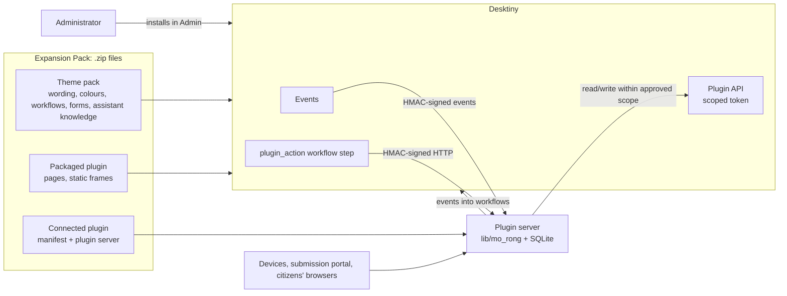

</details>

Desktiny's code is not modified. A plugin's scope is the part of permissions the administrator approved at install.
Arrow colours: blue is request/response, brown is an event, purple is a file, grey dashed is a manual step.

### From source to Desktiny

Part 1 of the animated diagram above shows this step.

<details>
<summary>Text diagram (Mermaid)</summary>

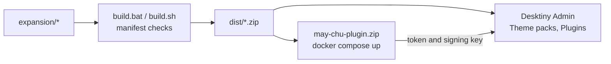

</details>

**Requirements:** Desktiny **3.1.0** or later (3.0.0 cannot install plugin `.zip` files and ignores the newer login
customisations); Python 3.11+ for packaging; Docker for connected plugin servers.

## Screens

Screenshots from the demo with fake sample data (provenance: [`docs/images/README.md`](docs/images/README.md)).

| 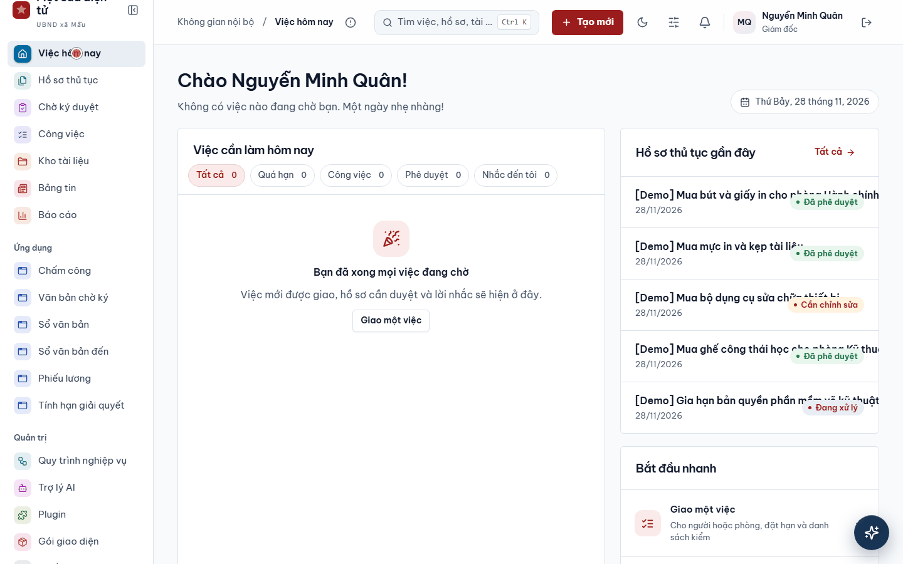 | 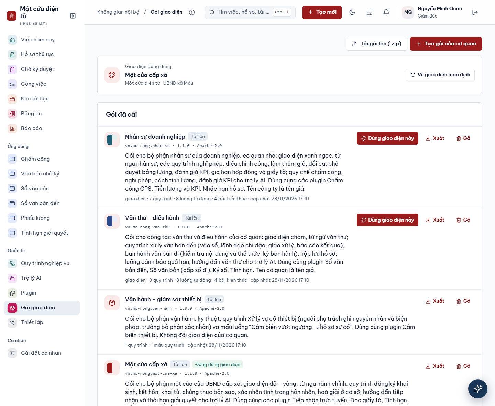 |
|---|---|
| A one-stop officer opens a home page with changed wording, colours and a to-do block | An administrator installs a pack and the theme, wording and workflows change with it |
| 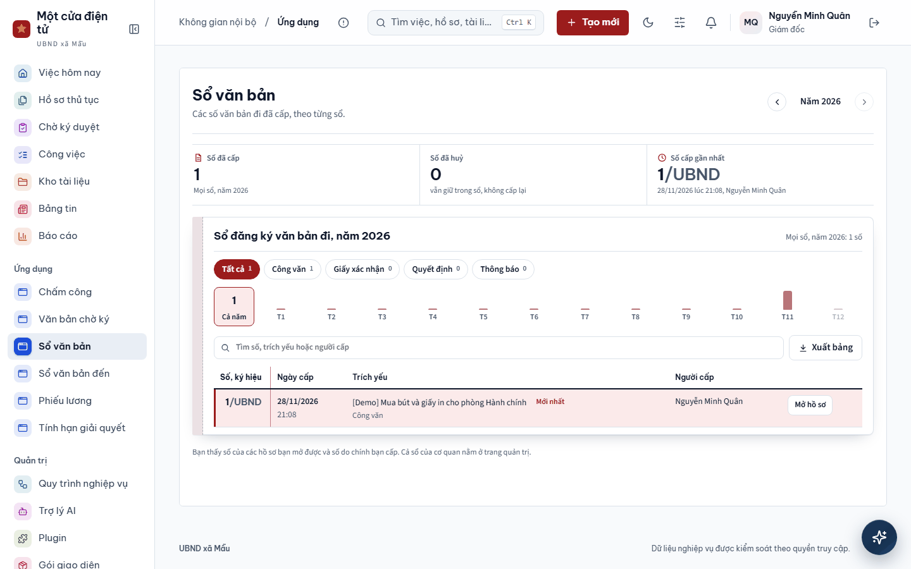 | 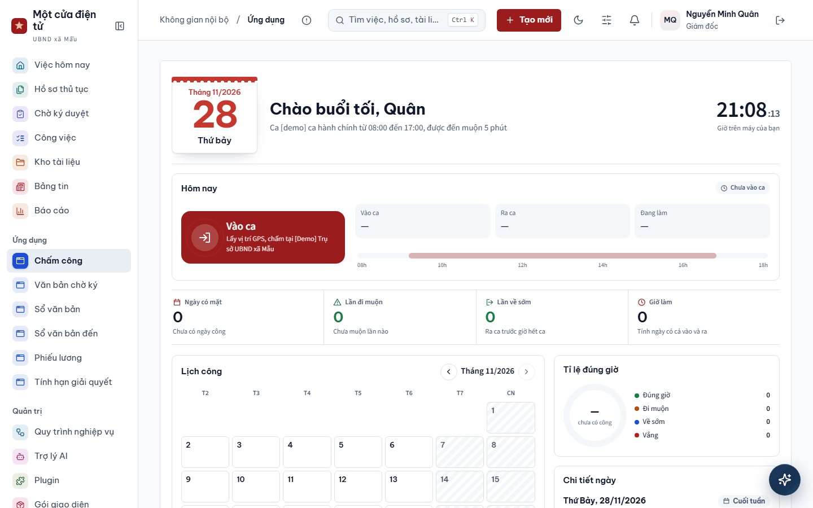 |
| A records clerk issues outgoing document numbers in sequence, with no gaps | An employee checks in using their phone's location |
| 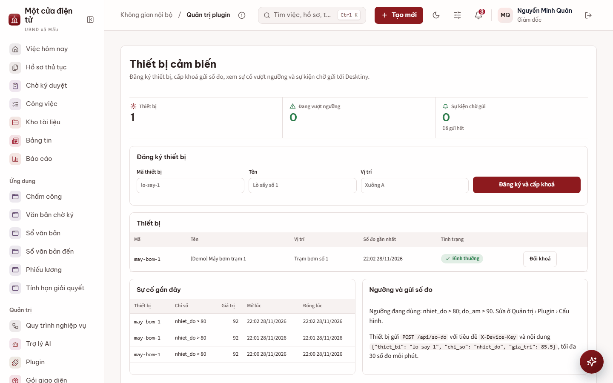 | 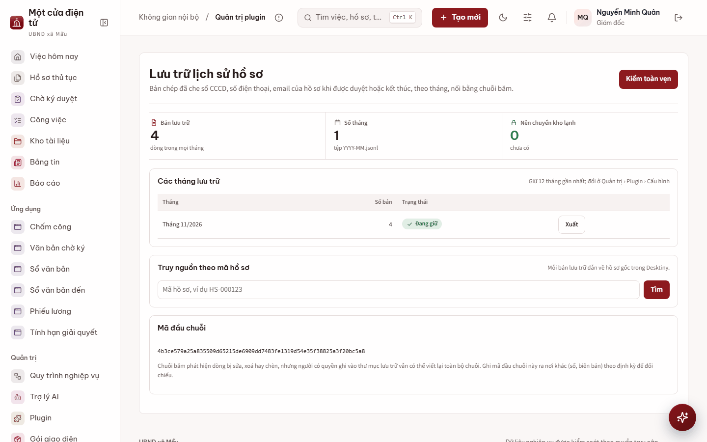 |
| The person in charge sees which reading is over its threshold | An administrator verifies the hash chain of archived cases |

<p align="center">
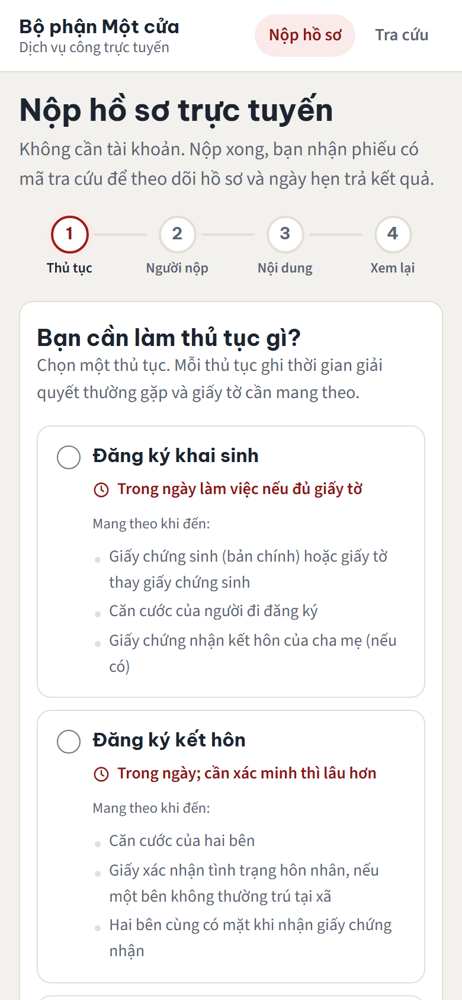<br>
A citizen submits an application from their phone.
</p>

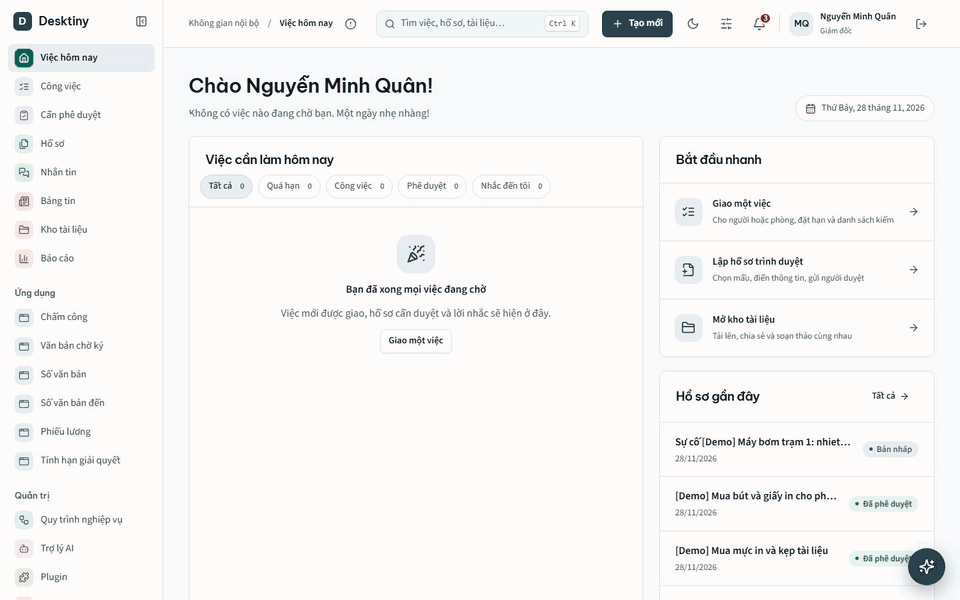

*An administrator installs a pack and Desktiny switches to the new line of work.*

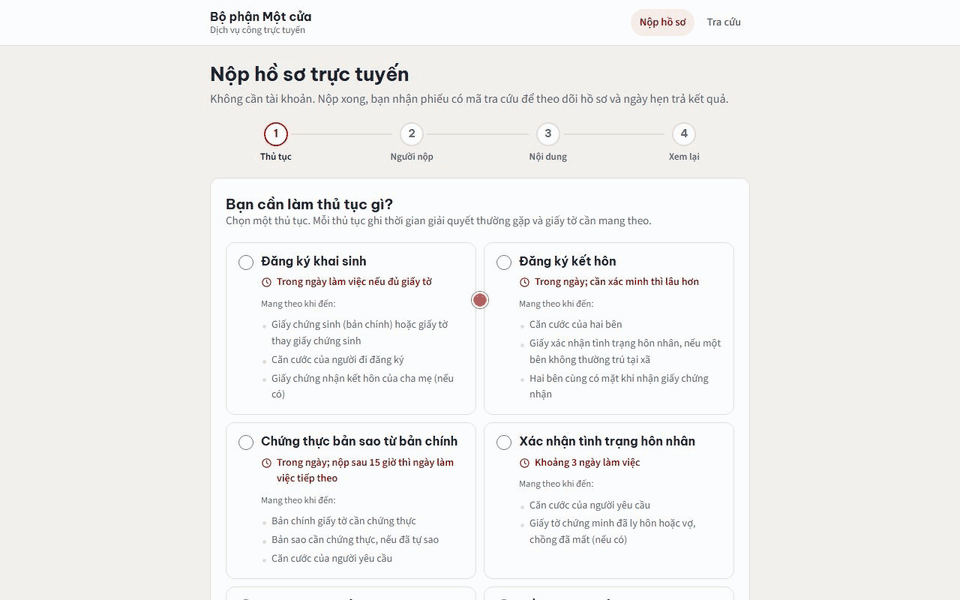

*A citizen submits through the public portal and the case appears for the officer.*

All data in the images and GIFs is fake sample data.

## Sample expansions

| Sample | For | Theme pack | Plugins |
|---|---|---|---|
| <br>[**Enterprise HR**](expansion/nhan-su/README.md) `nhan-su` | HR department of a company or small agency | 7 request workflows, 3 automations, policies for the AI assistant | GPS timekeeping, Payroll and KPI, Document deadline reminders |
| <br>[**Commune one-stop**](expansion/mot-cua-xa/README.md) `mot-cua-xa` | One-stop desk of a commune People's Committee | 6 procedures (civil registration, certification, mediation); 3 automations | Document register, Digital signing, Online intake, Deadline calculation, Document reading |
| <br>[**Records office**](expansion/van-thu/README.md) `van-thu` | Records clerks and administrative office | Handling incoming documents, issuing outgoing documents, filing; 3 automations; records guidance for the AI assistant | Incoming document register; shares the Document register, Digital signing and Deadline calculation plugins of the one-stop expansion |
| [**Operations: equipment monitoring**](expansion/van-hanh/README.md) `van-hanh` | Operations and technical teams with equipment to watch | An equipment-incident workflow; a flow template "sensor over threshold → incident case"; no change to the look | Device sensors (receive readings over HTTP, alert on threshold) |
| [**Data governance**](expansion/quan-tri-du-lieu/README.md) `quan-tri-du-lieu` (illustration) | Desktiny administrators | None | Case history archive: copies approved and closed cases (national ID, phone and email masked) into monthly files with a hash chain; integrity check, lineage back to the source case |

The Operations and Data governance expansions have no logo of their own yet. Each sample has its own README (in
Vietnamese): contents, installation, configuration, suggested flows and what to change before real use. Agency names in
the samples are made up; regulations, deadlines and amounts are illustrations only.

### How Operations and Data governance run

<p align="center">

<br><sub>Animated diagram, labels in Vietnamese: a sensor reading over the threshold becomes one queued event, then an incident case for the responsible person; a closed case becomes one masked, hash-chained archive line.</sub>
</p>

The readings in the chart are samples, in the style of `scripts/gia_lap_cam_bien.py`. With Desktiny 3.1.0, the flow
owner cannot yet submit a case created by a flow (fixed after 3.1.0). Details (in Vietnamese):
[Operations](expansion/van-hanh/README.md), [Data governance](expansion/quan-tri-du-lieu/README.md).

## Packaging

Pick one:

| Way | Command |
|---|---|
| Windows | **Double-click `build.bat`** → choose from the list (Enter = all); `dist` opens when done |
| VS Code | **Ctrl+Shift+B** → "Đóng gói (dist/*.zip)" |
| Command line | `python scripts/dong_goi.py` · `./build.sh` · `make build` |

Choose what to package by number or name, for example:

```sh
build.bat nhan-su                  # the whole HR expansion: pack + 3 plugins
build.bat ky-so so-van-ban         # just two plugins
build.bat goi-nhan-su              # just the theme pack (add goi- when expansion and pack share a name)
python scripts/dong_goi.py --chon  # show the numbered list, as when double-clicking
make build CHON="nhan-su ky-so"
```

Names are folder names of the expansion, pack or plugin (`plugin-<name>` also works). The server bundle contains only
the selected connected plugins, and `HUONG-DAN-CAI.txt` lists the matching `docker compose … up -d <those plugins>`
command.

For a real server, tell connected plugins where they live:

```sh
build.bat --host plugins.example.org       # or: python scripts/dong_goi.py --host plugins.example.org
                                           #     make build HOST=plugins.example.org
```

A `--host` with a dot (domain, IP) makes `base_url` `https://<host>/<plugin-name>` (put behind a reverse proxy); a host
without a dot gives `http://<host>:<port>`. Without `--host`, `base_url` is `http://localhost:92xx` (for trying on one
machine). Before writing anything, packaging **validates every manifest** by the rules Desktiny applies on upload, and
checks that every file a pack points to (logo, workflows, templates, knowledge) exists and is valid JSON; on an error it
names the file and writes nothing.

`dist/` is emptied and rewritten on every run. Packaging everything produces 19 files:

```
dist/
├── HUONG-DAN-CAI.txt                       which file to upload where, in order
├── nhan-su/            goi-nhan-su-1.2.1.zip, plugin-cham-cong, plugin-luong-kpi, plugin-nhac-han
├── mot-cua-xa/         goi-mot-cua-xa-1.2.1.zip, plugin-tinh-han, plugin-doc-giay-to,
│                       plugin-so-van-ban, plugin-ky-so, plugin-tiep-nhan
├── van-thu/            goi-van-thu-1.1.1.zip, plugin-so-van-ban-den
│                       + copies of plugin-so-van-ban, plugin-ky-so, plugin-tinh-han (shared)
├── van-hanh/           goi-van-hanh-1.0.0.zip, plugin-cam-bien-1.0.0.zip
├── quan-tri-du-lieu/   plugin-luu-tru-lich-su-1.0.0.zip
└── may-chu-plugin/     may-chu-plugin-1.1.0.zip   server code of 9 connected plugins + Dockerfile + compose.yaml
```

A connected plugin's `.zip` holds only the manifest (pages are served by the plugin server); a packaged plugin holds
manifest, pages and the frame SDK. File names carry the manifest `version`. The same source always produces the same
`.zip`.

## Install into Desktiny

Open `dist/HUONG-DAN-CAI.txt` for the exact files and order. In general:

1. **Theme pack:** **Quản trị › Gói giao diện › Tải gói lên (.zip)** → pick `goi-*.zip` → preview → install → **Dùng giao
   diện này**. You need permission to manage forms and the AI assistant. Several packs can be installed but only one is
   the active theme. Automations in a pack are installed **off**: review recipients, then turn them on.
2. **Packaged plugin:** **Quản trị › Plugin › Cài plugin** → `plugin-*.zip` → **Duyệt quyền**. No server needed.
3. **Plugin server:** copy and unzip `may-chu-plugin-*.zip` on a server; `cp deploy/.env.example deploy/.env` and set
   `DESKTINY_URL`; run `docker compose -f deploy/compose.yaml --env-file deploy/.env up -d --build` (from source:
   `make up`). One image serves all plugins; each plugin's SQLite data lives in its own volume. In Desktiny's
   configuration add the server to `PLUGIN_ALLOWED_HOSTS` and its origin to `PLUGIN_FRAME_SOURCES`.
4. **Connected plugin:** install `plugin-<name>-*.zip` and approve permissions. Desktiny shows the **token** and **signing
   key** exactly once; copy them into `deploy/.env` (`<NAME>_TOKEN`, `<NAME>_SECRET`) and re-run `docker compose … up -d`.
5. **Configure:** each plugin has a **Cấu hình** button on the Plugin page (per-agency settings; secret fields are
   encrypted).

## Build your own expansion

Most needs only require a theme pack and no code. Add a plugin only when Desktiny lacks the feature. Full guide with
sample code (Vietnamese): [`docs/tu-tao-ban-mo-rong.md`](docs/tu-tao-ban-mo-rong.md).

1. Create `expansion/<name>/` (copy the closest sample and edit it).
2. Theme pack: build it inside Desktiny and export, or write `desktiny-pack.json` by hand.
3. Packaged plugin for a page or calculation that runs in the browser.
4. Connected plugin for stored data, background work, events or workflow steps (use `lib/mo_rong`).
5. Package with `build.bat <name>`, install on a test Desktiny, write tests, write the README, then go through the
   pre-release checklist.

## Security model

| Channel | Authentication | Scope |
|---|---|---|
| Desktiny calls a plugin: events, `plugin_action` steps, assistant tools | HMAC-SHA256 signature over `<timestamp>.<body>` (`X-Desktiny-Signature`, `X-Desktiny-Timestamp`), with a check on the call's age. Reports of long-running steps are signed too | Only what Desktiny signed with that plugin's own signing key |
| A plugin calls Desktiny's API | Installation token (`Bearer`), issued once when permissions are approved | The intersection of the approved permissions and the token; only cases the plugin was told about or that belong to a chosen workflow; form fields can be written only within one user's session |
| A plugin page calls its plugin server | The frame's session token (`X-Desktiny-Session`); the server asks Desktiny who the viewer is (`GET /plugin/v1/me`) | The viewer's own rights; routes marked `admin=True` accept only a session from the `admin.page` frame (organisation managers) |
| A device posts readings (Sensor plugin) | Device key `X-Device-Key`, only its SHA-256 hash is stored | One registered device, limited to 30 readings per minute |

Other measures:

- Plugin pages run in an isolated frame, with no `alert/prompt` and no file downloads.
- The plugin server returns every error as JSON; unexpected errors go only to the container log. `X-Forwarded-For` is
  trusted only when `TRUST_PROXY=1`.
- Containers run as a normal user with a read-only filesystem and `no-new-privileges`. The server bundle never contains
  `deploy/.env`.
- A theme pack is plain data, no code. Removing it returns Desktiny to its default look and workflows.

Report vulnerabilities: see [SECURITY.md](SECURITY.md).

## Technology and licences

| Layer | Component | Version | Licence (SPDX) | Role | Use |
|---|---|---|---|---|---|
| Plugin server | Python standard library (`http.server`) | Python ≥ 3.11 (CI uses 3.13) | PSF (the language) | HTTP server, routing, signature checks (`lib/mo_rong`) | No pip dependencies |
| Data | SQLite (standard library) | follows Python | Public domain | Each plugin's own data, one volume per plugin | Embedded in the process |
| Deployment | Docker Compose, image `python:3.13.5-slim-bookworm` | 3.13.5 | Licence of the base image | One shared image for all connected plugins | Separate service |
| Python SDK | `lib/desktiny_plugin` | copy of Desktiny's SDK | Apache-2.0 | Sign, verify, call the plugin API | Bundled code |
| Page SDK | `sdk/desktiny-plugin-sdk.js`, `mo-rong.js`, `bieu-do.js`, `chung.css` | same as this repo | Apache-2.0 | Plugin pages talk to Desktiny's frame and the plugin server | Bundled code |
| Fonts | Be Vietnam Pro, Source Sans 3 (`sdk/phong-chu/`) | latin, vietnamese subsets | OFL-1.1 | Type for plugin pages | Bundled `.woff2` files |
| Tools | pytest ≥ 8, ruff ≥ 0.6, Node 22 (`node --test`) | see `pyproject.toml` | MIT / MIT / MIT | Tests, lint | Not part of the product |

Details and sources: [THIRD_PARTY.md](THIRD_PARTY.md), [NOTICE](NOTICE). Every file declares its licence following the
[REUSE](https://reuse.software/) standard.

## Limits

- **GPS timekeeping** trusts the location the browser reports, so a technical user can fake it. Browsers give location
  only on HTTPS pages (except `localhost`).
- **The online intake portal** stores national ID and phone numbers unencrypted, with no retention period. Fix this
  before using real data.
- **Digital signing** is a simulated HMAC signature, not a legally valid digital signature.
- Regulations, procedures, deadlines, holidays and amounts in the samples are illustrations only.

## Development and tests

```
build.bat, build.sh     packaging button (calls scripts/dong_goi.py)
scripts/                dong_goi.py (validate, package), kiem_phien_ban.py, gia_lap_cam_bien.py
expansion/<name>/       the expansions (README.md, packs/, plugins/)
lib/mo_rong/            plugin server kit: routing, signature checks, viewer sessions, rate limits, SQLite, Word files, Vietnamese helpers
lib/desktiny_plugin/    copy of Desktiny's Python SDK, updated together with Desktiny
sdk/                    Desktiny's frame SDK, mo-rong.js (pages call the plugin server), chung.css, fonts
tests/                  plugin server tests (fake Desktiny), packaging tests, tests/js (Node), tests/desktiny (real Desktiny)
deploy/                 Dockerfile, compose.yaml, .env.example
docs/                   build-your-own guide, images and GIFs used in the README
```

| Command | Checks | Needs |
|---|---|---|
| `make test` | Plugin servers and packaging | Python 3.11+, pytest |
| `make test-js` | Page code of packaged plugins | Node 22 |
| `make test-desktiny` | Installs every pack and plugin into a real Desktiny and runs the flows | Desktiny source (`DESKTINY_DIR`, default parent folder) |
| `make lint` | Python style and errors | ruff |
| `make dist` | Trial packaging into `dist/` | Python 3.11+ |
| `reuse lint` | Every file declares its licence | the `reuse` tool |

Without `make` (Windows): `set PYTHONPATH=lib`, then `python -m pytest -q tests --ignore=tests/desktiny` and
`node --test tests/js/*.test.mjs`. CI runs lint, tests, JS tests, packaging, and a trial install into Desktiny `v3.1.0`.

Run a plugin by hand:

```sh
PYTHONPATH=lib DESKTINY_URL=… DESKTINY_TOKEN=… DESKTINY_SECRET=… python expansion/nhan-su/plugins/cham-cong/server.py
PYTHONPATH=lib python -m desktiny_plugin.cli dev step cap_so_van_ban --secret … --manifest expansion/mot-cua-xa/plugins/so-van-ban/desktiny-plugin.json
```

The second command plays Desktiny: it signs and sends a workflow-step call to a running plugin server.

## Contributing

Process: open an issue (forms provided) → branch `feat/<number>-<name>` → pull request reviewed by someone else → merge
once CI is green. See [CONTRIBUTING.md](CONTRIBUTING.md), [SECURITY.md](SECURITY.md) and
[CODE_OF_CONDUCT.md](CODE_OF_CONDUCT.md) (Vietnamese). Bugs and proposals go to
[Issues](https://github.com/Dking2007/Desktiny_expansion_pack/issues); vulnerabilities go privately through a
[Security Advisory](https://github.com/Dking2007/Desktiny_expansion_pack/security/advisories/new).

## Team

Areas follow this repository's commit history (`git log --no-merges`).

| GitHub | Commits | Main areas |
|---|---|---|
| [@Dking2007](https://github.com/Dking2007) | 36 | Sensor and History archive plugins, permission, security and robustness fixes in the one-stop and HR plugins, CI trial install into Desktiny and version checks, CHANGELOG and community files |
| [@Mai1174](https://github.com/Mai1174) | 17 | Plugin server kit, the first plugins (Timekeeping, Payroll and KPI, Document register, Digital signing, Reminders, Intake, Deadlines, Document reading), HR, one-stop and records packs, packaging and deployment |
| [@Raphael-Fug](https://github.com/Raphael-Fug) | 5 | Visual interfaces for the plugins, choosing packs and plugins when packaging, per-expansion folder layout |

## Licence

Apache-2.0 ([LICENSE](LICENSE)). Bundled fonts are under SIL OFL 1.1; see [THIRD_PARTY.md](THIRD_PARTY.md).
