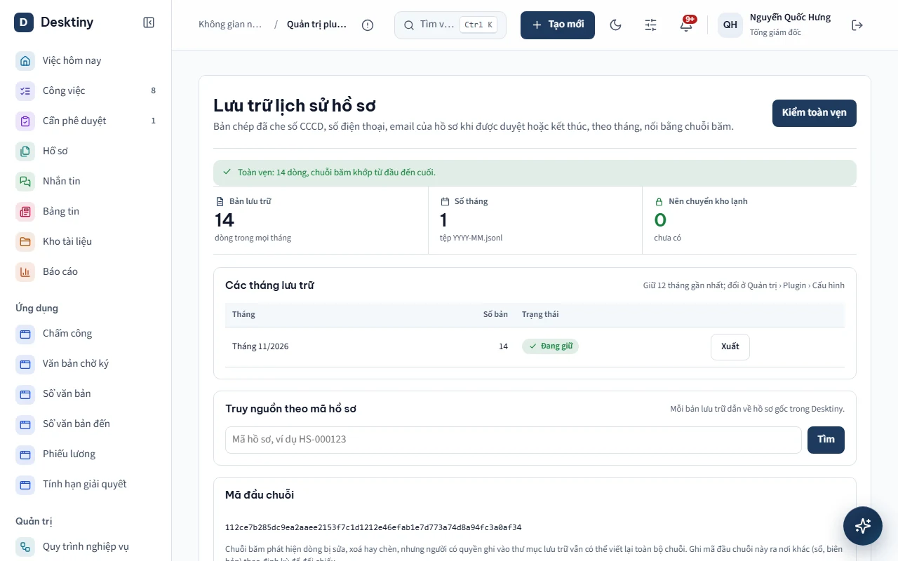

<!--
SPDX-License-Identifier: Apache-2.0
SPDX-FileCopyrightText: 2026 Desktiny Expansion Pack contributors
-->


# Bản minh hoạ: Quản trị dữ liệu

> **1** plugin riêng · Cần Desktiny **3.1.0** trở lên · Giấy phép Apache-2.0

<p align="center">
  
</p>

<sub>Ảnh chụp từ bản chạy thử với dữ liệu mẫu: tên người, cơ quan, số liệu là giả. Plugin nhận màu của gói giao diện đang dùng nên đổi theo màu gói.</sub>

Bản mở rộng này **minh hoạ** ba việc của quản trị dữ liệu trên Desktiny, không phải một kho dữ liệu (data lake):

- **Vòng đời dữ liệu:** hồ sơ đã duyệt hoặc đã kết thúc được chép ra khỏi dữ liệu đang dùng của Desktiny, theo tháng;
  tháng nào quá thời gian giữ thì được đánh dấu để chuyển sang kho lạnh.
- **Truy nguồn (lineage):** mỗi bản lưu trữ ghi mã hồ sơ, biểu mẫu, phiên bản, sự kiện và thời điểm; tra theo mã hồ sơ
  thì thấy mọi phiên bản đã lưu và mở được hồ sơ gốc.
- **Toàn vẹn và chất lượng:** các bản lưu trữ nối nhau bằng chuỗi băm sha256; sửa, xoá hay chèn một dòng đều bị phát
  hiện. Số CCCD, số điện thoại, email được che trước khi ghi.

```
expansion/quan-tri-du-lieu/
└── plugins/
    └── luu-tru-lich-su/     Lưu trữ lịch sử hồ sơ   (plugin kết nối, cổng 9209)
```

Bản này không có gói giao diện; plugin dùng được với mọi gói.

## Plugin Lưu trữ lịch sử hồ sơ `luu-tru-lich-su`

| | |
|---|---|
| Nhận sự kiện | `case.approved` (hồ sơ được duyệt), `case.closed` (hồ sơ kết thúc: duyệt, từ chối hoặc huỷ) |
| Quyền | `cases.read`: đọc hồ sơ vừa có sự kiện |
| Cấu hình | `giu_thang`: giữ bao nhiêu tháng trong plugin trước khi đánh dấu chuyển kho lạnh (mặc định 12) |
| Gắn vào Desktiny | Trang quản trị của plugin (chỉ người quản lý tổ chức mở được) |

### Mỗi bản lưu trữ

Mỗi sự kiện ghi thêm **một dòng JSON** vào `archive/YYYY-MM.jsonl` (tháng lưu trữ) trong volume của plugin:

| Trường | Nghĩa |
|---|---|
| `case_id`, `code`, `title` | hồ sơ gốc (mã `HS-000123`); tên hồ sơ cũng được che |
| `form_id`, `form_name` | biểu mẫu, quy trình của hồ sơ |
| `version` | phiên bản hồ sơ: `updated_at` mà Desktiny trả về (API plugin chưa có số revision) |
| `event`, `event_id`, `occurred_at` | sự kiện và thời điểm Desktiny ghi nhận |
| `archived_at` | thời điểm plugin ghi dòng này |
| `payload` | nội dung biểu mẫu, đã che số CCCD, số điện thoại, email |
| `sha256` | sha256 của `payload` dạng JSON chuẩn hoá (khoá xếp thứ tự, không khoảng trắng) |
| `prev` | sha256 của nguyên dòng ngay trước (nối qua các tháng); dòng đầu tiên là 64 số 0 |

Mỗi cặp (hồ sơ, phiên bản, sự kiện) chỉ ghi một lần: Desktiny gửi lại sự kiện thì không sinh dòng trùng. Hồ sơ được
duyệt có hai dòng (`case.approved` rồi `case.closed`) vì Desktiny phát cả hai sự kiện.

### Trang quản trị

- **Các tháng lưu trữ:** số bản mỗi tháng; tháng quá thời gian giữ hiện “nên chuyển kho lạnh”. Plugin **không xoá** gì:
  quản trị viên chép tệp đi rồi tự xoá trong volume.
- **Xuất:** hiện nội dung tệp tháng để sao chép (khung plugin không tải tệp về được).
- **Kiểm toàn vẹn:** đọc lại mọi dòng theo thứ tự, kiểm `sha256` của nội dung và `prev` nối với dòng trước. Kết quả là
  “toàn vẹn” hoặc tệp và dòng hỏng đầu tiên.
- **Truy nguồn theo mã hồ sơ:** mọi phiên bản đã lưu của hồ sơ (tháng, dòng, sự kiện, sha256, nội dung đã che) và nút
  mở hồ sơ gốc trong Desktiny.
- **Mã đầu chuỗi:** sha256 của dòng cuối cùng. Ghi ra nơi khác theo định kỳ để đối chiếu.

## Cài đặt

Cài theo [hướng dẫn chung](../../README.md#cài-vào-desktiny):

1. `build.bat quan-tri-du-lieu` (hoặc `python scripts/dong_goi.py quan-tri-du-lieu`).
2. Cài `plugin-luu-tru-lich-su-1.0.0.zip`, duyệt quyền, chép token và khoá ký vào `deploy/.env`
   (`LUU_TRU_LICH_SU_TOKEN`, `LUU_TRU_LICH_SU_SECRET`), rồi chạy dịch vụ `luu-tru-lich-su` (cổng 9209).
3. Sao lưu volume `luu-tru-lich-su` như mọi dữ liệu hồ sơ.

## Giới hạn (đọc trước khi dùng thật)

- **Không phải data lake.** Tệp JSONL thường, không lưu dạng cột, không có công cụ truy vấn; chỉ tra được theo mã hồ
  sơ. Chỉ mục tra cứu nằm trong bộ nhớ, dựng lại từ các tệp mỗi khi plugin khởi động.
- **Chuỗi băm phát hiện sửa đổi, không ngăn được.** Ai có quyền ghi vào volume vẫn có thể viết lại toàn bộ chuỗi cho
  khớp. Muốn phát hiện cả việc đó, phải giữ mã đầu chuỗi ở nơi khác (sổ, biên bản, hệ thống khác). Sửa các trường ngoài
  `payload` của **dòng cuối** hoặc cắt bỏ các dòng cuối cũng chỉ lộ ra khi đối chiếu mã đầu chuỗi.
- **Che dữ liệu cá nhân bằng mẫu ký tự:** che email, dãy đúng 12 chữ số (CCCD), 9 chữ số (CMND cũ), số điện thoại
  bắt đầu bằng 0 hoặc +84 có 10 chữ số (cho phép dấu cách, chấm, gạch). **Không** che họ tên, địa chỉ, ngày sinh, số viết
  theo cách khác (ví dụ `(091) 234 5678`, số lưu dạng số thay vì chữ), tệp đính kèm. Một số khác có 9 hoặc 12 chữ số (số
  tài khoản) cũng bị che. Cần chính sách che dữ liệu đầy đủ hơn thì thay hàm `redact` trong `server.py`.
- **Phiên bản** là `updated_at` của hồ sơ, không phải số revision.
- **Kho lạnh** chỉ là đánh dấu: chuyển tệp đi, nén, mã hoá là việc của quản trị viên. Khi các tháng đầu đã chuyển đi,
  kiểm toàn vẹn bắt đầu từ tháng sớm nhất còn lại.
- **Xuất tháng** đưa cả tệp vào trang; tệp tháng rất lớn thì lấy thẳng từ volume.
