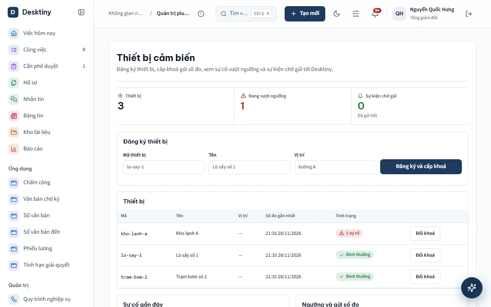
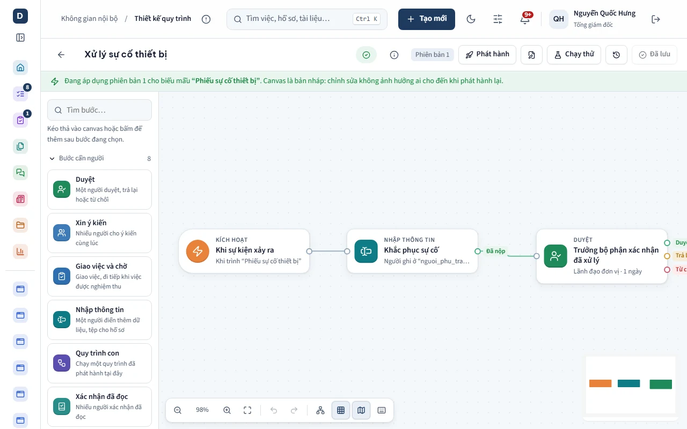

<!--
SPDX-License-Identifier: Apache-2.0
SPDX-FileCopyrightText: 2026 Desktiny Expansion Pack contributors
-->

# Bản mẫu: Vận hành – giám sát thiết bị

> Gói `vn.mo-rong.van-hanh` **1.0.0** · **1** plugin riêng · Cần Desktiny **3.1.0** trở lên · Giấy phép Apache-2.0

<p align="center">
  
  
</p>

<sub>Ảnh chụp từ bản chạy thử với dữ liệu mẫu: tên người, cơ quan, số liệu là giả. Plugin nhận màu của gói giao diện đang dùng nên đổi theo màu gói.</sub>

Bản mở rộng mẫu nối **thiết bị ở hiện trường** (lò sấy, kho lạnh, trạm bơm…) với **quy trình xử lý của Desktiny**:
thiết bị gửi số đo, số đo vượt ngưỡng thành sự kiện, luồng tự động tạo hồ sơ sự cố, quy trình giao cho người phụ trách.

```
expansion/van-hanh/
├── packs/van-hanh/           gói “Vận hành – giám sát thiết bị” (quy trình + mẫu luồng, không đổi giao diện)
└── plugins/
    └── cam-bien/             Cảm biến thiết bị     (plugin kết nối, cổng 9208)
scripts/gia_lap_cam_bien.py   giả lập một thiết bị để trình diễn
```

## Bản mẫu này chứng minh gì

```
thiết bị ──POST /api/so-do──▶ plugin Cảm biến ──sự kiện canh_bao_cam_bien──▶ luồng tự động ──▶ hồ sơ sự cố
 (khoá riêng)                 (ngưỡng, chống lặp,                            (Tạo hồ sơ)       │
                               hàng đợi khi Desktiny tạm dừng)                                  ▼
                                                                      quy trình “Xử lý sự cố thiết bị”:
                                                                      người phụ trách khắc phục → trưởng bộ phận xác nhận
```

- **Mỗi sự cố một hồ sơ.** Số đo đầu tiên vượt ngưỡng mở sự cố và gửi đúng một sự kiện; các số đo vượt tiếp theo không
  gửi thêm. Một số đo bình thường đóng sự cố; lần vượt sau là sự cố mới.
- **Không mất cảnh báo khi Desktiny tạm dừng.** Sự kiện được ghi vào hàng đợi trong SQLite trước khi gửi; gửi không
  được thì plugin thử lại mỗi phút với cùng khoá chống trùng (Idempotency-Key), nên gửi lại không thành hai sự kiện.
- **Giao đúng người.** Người phụ trách (cấu hình của plugin) đi theo sự kiện vào trường `nguoi_phu_trach` của hồ sơ;
  bước “Khắc phục sự cố” của quy trình hỏi đúng người ghi trong trường đó.

Toàn bộ chuỗi được kiểm trên một Desktiny thật (`tests/desktiny`, test
`test_a_sensor_past_its_threshold_becomes_an_incident_dossier_for_the_configured_person`): cài plugin và gói, bật
luồng từ mẫu, gửi số đo 70 → 92 → 95, đúng một hồ sơ sự cố được tạo với số đo 92 và người phụ trách; một hồ sơ cùng
nội dung khi trình thì bước *Khắc phục sự cố* được giao cho người đó (xem giới hạn cuối trang về hồ sơ nháp).

## Plugin `cam-bien` (Cảm biến thiết bị)

| Phần | Nội dung |
|---|---|
| Nhận số đo | `POST /api/so-do`, tiêu đề `X-Device-Key: <khoá>`, nội dung `{"thiet_bi": "lo-say-1", "chi_so": "nhiet_do", "gia_tri": 85.5, "thoi_diem": "2026-11-28T08:00:00+07:00"}` (`thoi_diem` không bắt buộc, phải có múi giờ). Thiếu khoá: 401; sai khoá hoặc thiết bị chưa đăng ký: 403; dữ liệu sai: 422; quá 30 số đo mỗi phút cho một thiết bị: 429. |
| Khoá thiết bị | Cấp ở trang quản trị khi đăng ký hoặc **Đổi khoá**; hiện đúng một lần, máy chủ chỉ giữ mã băm SHA-256. |
| Ngưỡng | Cấu hình `nguong`: `nhiet_do>80; nhiet_do<5; do_am>90` (một chỉ số có thể có ngưỡng trên và dưới). Chỉ số không có ngưỡng chỉ được lưu và vẽ. |
| Sự kiện | **Cảm biến vượt ngưỡng** (`canh_bao_cam_bien`): `thiet_bi`, `ten_thiet_bi`, `vi_tri`, `chi_so`, `gia_tri`, `nguong`, `thoi_diem`, `nguoi_phu_trach`. Khoá kích hoạt trong luồng: `plugin.vn.mo-rong.cam-bien.canh_bao_cam_bien`. |
| Lưu trữ | SQLite trong volume của plugin. Số đo và sự cố đã đóng cũ hơn `luu_ngay` ngày (mặc định 30) bị xoá mỗi phút. |
| Khối trang chủ | Mỗi thiết bị: số đo mới nhất của từng chỉ số, ngưỡng, biểu đồ 30 số đo gần nhất (`sdk/bieu-do.js`), tô đỏ chỉ số đang vượt. |
| Trang quản trị | Đăng ký thiết bị, đổi khoá, danh sách thiết bị và sự cố gần đây, số sự kiện đang chờ gửi (tự gửi lại mỗi phút), sự kiện Desktiny từ chối. |

## Gói `vn.mo-rong.van-hanh`

| Phần | Nội dung |
|---|---|
| Quy trình và biểu mẫu | **Xử lý sự cố thiết bị**, biểu mẫu “Phiếu sự cố thiết bị” (thiết bị, chỉ số, giá trị, ngưỡng, thời điểm, người xử lý). Bước 1 *Khắc phục sự cố*: người ghi trong `nguoi_phu_trach` nhập nguyên nhân, biện pháp, đính kèm ảnh. Bước 2: trưởng bộ phận xác nhận. |
| Mẫu luồng | **Cảm biến vượt ngưỡng → hồ sơ sự cố**: kích hoạt bằng sự kiện của plugin, bước *Tạo hồ sơ* điền sẵn mọi trường từ sự kiện. |
| Giao diện | Không đổi: gói dùng được cùng gói giao diện đang dùng của cơ quan. |

Vì sao là **mẫu luồng** chứ không phải luồng tự động cài sẵn: Desktiny kiểm mọi luồng trong gói khi cài, mà bước *Tạo
hồ sơ* cần mã của một biểu mẫu đã phát hành, còn biểu mẫu của gói chỉ có mã sau khi cài. Mẫu luồng thì được cài
nguyên; cơ quan mở nó, chọn biểu mẫu “Phiếu sự cố thiết bị” ở bước *Tạo hồ sơ* rồi bật.

## Cài đặt

Cài theo [hướng dẫn chung](../../README.md#cài-vào-desktiny), với các điểm riêng:

1. `build.bat van-hanh` (hoặc `python scripts/dong_goi.py van-hanh`).
2. Máy chủ plugin: cổng **9208**, biến `CAM_BIEN_TOKEN`, `CAM_BIEN_SECRET` trong `deploy/.env`. Thiết bị phải tới
   được cổng này (mạng nội bộ của nhà máy, hoặc qua reverse proxy có HTTPS).
3. Gói và plugin cài theo thứ tự nào cũng được, nhưng plugin phải được duyệt và bật trước khi dựng luồng từ mẫu: luồng
   chỉ lưu được với sự kiện của plugin đang bật.
4. **Cấu hình** plugin: ngưỡng, người xử lý sự cố (tài khoản hoặc họ tên đúng như trong Desktiny), số ngày giữ số đo.
5. **Quy trình nghiệp vụ › Tạo quy trình** → mẫu “Cảm biến vượt ngưỡng → hồ sơ sự cố” → ở bước *Tạo hồ sơ* chọn biểu
   mẫu “Phiếu sự cố thiết bị” → lưu → bật.
6. Trang quản trị của plugin → **Đăng ký thiết bị** → chép khoá vào thiết bị.

Luồng tạo hồ sơ ở dạng **nháp**, do người bật luồng làm chủ (Desktiny không tự trình hồ sơ do luồng tạo). Người đó
nhận thông báo, xem lại rồi **Trình**; từ đó quy trình chạy và giao cho người phụ trách.

## Trình diễn

```sh
PYTHONPATH=lib DESKTINY_URL=… DESKTINY_TOKEN=… DESKTINY_SECRET=… python expansion/van-hanh/plugins/cam-bien/server.py
python scripts/gia_lap_cam_bien.py --khoa <khoá của lo-say-1> --url http://localhost:9208
```

Giả lập gửi 10 số đo quanh 65 °C, giữa chừng ba số đo 92–95 °C: một sự cố mở, rồi đóng khi số đo trở lại bình thường.
Khối trang chủ hiện đường số đo với đoạn vượt ngưỡng.

## Giới hạn (cần biết trước khi dùng thật)

- **Chỉ nhận qua HTTP(S)** với khoá riêng từng thiết bị. Chưa có MQTT, OPC UA, Modbus: thiết bị chỉ nói các giao thức
  đó cần một gateway chuyển sang HTTP.
- **Không phải cơ sở dữ liệu chuỗi thời gian.** Số đo nằm trong SQLite, giữ theo số ngày cấu hình, tối đa 30 số đo mỗi
  phút cho một thiết bị; hợp với vài chục thiết bị báo mỗi vài giây đến vài phút, không hợp với hàng nghìn điểm đo tần số
  cao. Biểu đồ chỉ là 30 số đo gần nhất, không có báo cáo lịch sử.
- **Ngưỡng tĩnh, so từng số đo.** Không có trễ (hysteresis), trung bình trượt hay phát hiện bất thường; một số đo dao
  động quanh ngưỡng sẽ mở/đóng sự cố nhiều lần. Sự cố được xét theo thứ tự số đo tới, không theo `thoi_diem`.
- **Bộ giới hạn tần suất nằm trong bộ nhớ** của một tiến trình; khởi động lại thì đếm lại.
- Sự kiện mở sự cố được gửi ngay trong lời gọi của thiết bị; Desktiny chậm thì lời đáp cho thiết bị đó chậm theo
  (tối đa 10 giây), nhưng sự kiện vẫn nằm trong hàng đợi.
- Hồ sơ do luồng tạo là bản nháp chờ người bật luồng trình (cách Desktiny làm với bước *Tạo hồ sơ*). Với Desktiny
  3.1.0, trình bản nháp đó trả lỗi 404 (dữ liệu biểu mẫu tạo bằng danh tính dịch vụ của luồng nên chủ hồ sơ chưa đọc
  được ở Core): hồ sơ sự cố vẫn được tạo và báo cho chủ hồ sơ, nhưng bước giao người phụ trách chỉ chạy với hồ sơ trình
  được. Desktiny nhánh `tich-hop/olp-2026-11-28` đã sửa: chủ hồ sơ trình được bản nháp do luồng tạo.
